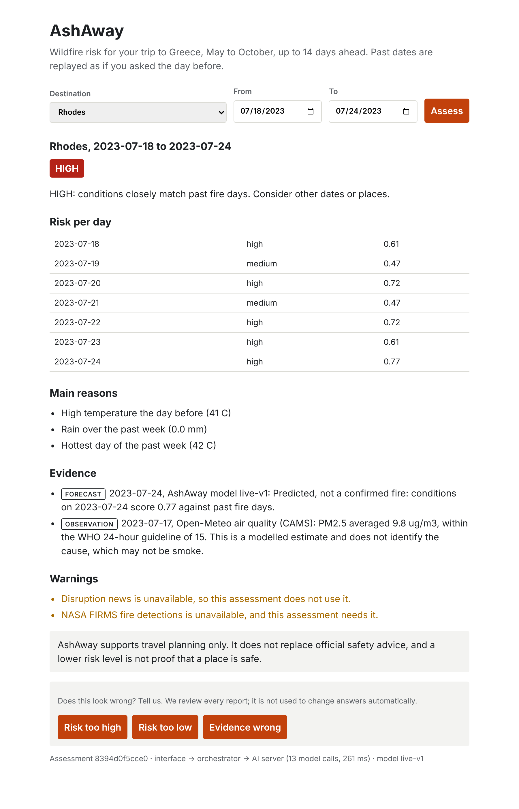

# Distributed architecture (Task 6, revised in Task 7)

AshAway runs as three logical servers. They can share one machine, but each is its own process with its own port, and they only talk over HTTP.

```
 browser / client
        │  HTTP :8000
        ▼
 ┌──────────────┐  HTTP :8001  ┌────────────────┐  HTTP :8002  ┌─────────────┐
 │  interface   │ ───────────▶ │  orchestrator  │ ───────────▶ │  AI server  │
 │  web page,   │ ◀─────────── │  feeds, checks,│ ◀─────────── │  the model  │
 │  checks      │              │  evidence,     │              │  only       │
 │  (no data)   │              │  storage       │              │             │
 └──────────────┘              └───┬────────┬───┘              └─────────────┘
                                   │        │ HTTPS
                           SQLite file    Open-Meteo, NASA FIRMS
```

| Server | Code | Port | Does | Never does |
|---|---|---|---|---|
| Interface | `src/ashaway/services/interface.py`, `static/index.html` | 8000 | Web page and JSON API. Checks every request (place, dates, season, horizon) before passing it on. Forwards valid requests, and requests for stored assessments and feedback, to the orchestrator. Keeps no data. | Call the AI server or touch the database. It has no address for the AI server and doesn't import the model code, XGBoost, pandas or the storage code (test I9 checks this). |
| Orchestrator | `src/ashaway/services/orchestrator.py`, `store.py` | 8001 | Runs the Task 5 assessment logic: feeds, features, evidence checks, alternatives, comparisons. Sends every prediction to the AI server through `RemoteModel`. Turns an AI outage into a 503. Stores every assessment, its outcome and feedback in SQLite. | Load the model. |
| AI server | `src/ashaway/services/ai.py` | 8002 | Loads the saved model (`models/live-v1`) and serves `/model` and `/predict`. | Know about places, dates or feeds. |

## Why the data sits behind the orchestrator

In the Task 6 version the interface kept its own SQLite file. The lecturer asked why it wasn't behind the orchestrator as well, and we agreed: the interface should only take requests and pass them on. Since Task 7 (T24) the orchestrator owns the storage. The interface is stateless, so it can be restarted, replaced or run several times without losing anything, and all data sits behind one server, next to the work that produces it. A request the interface refuses never reaches the orchestrator, so it is not stored; it only appears in the interface's log.

## Why HTTP and not a message queue

Every request needs an answer while the traveller waits, the work takes well under a second, and there are three services. Synchronous HTTP keeps the system small and easy to demonstrate. A broker such as RabbitMQ would add a fourth process to install and run without changing what the traveller sees. If assessments ever take long enough to need background jobs, the orchestrator is the place to add a queue; the interface and AI server wouldn't change.

## API

All errors use one shape: `{"error": {"code", "message", "service"}}`.

**Interface (:8000)**

| Method and path | Does |
|---|---|
| `GET /` | Web page |
| `GET /api/destinations` | Supported destinations |
| `POST /api/assess` `{place, start, end}` | 200 with `{id, assessment, trace}`; 400 for a bad request; 503 when the orchestrator or AI server is down |
| `POST /api/compare` `{places, start, end}` | Side-by-side rows |
| `GET /api/assessments`, `GET /api/assessments/{id}` | Stored requests and outcomes, fetched from the orchestrator |
| `POST /api/assessments/{id}/feedback` `{verdict, comment?}` | Report a wrong assessment (SRS AI8); checked here, stored by the orchestrator |
| `GET /health` | Own status and the orchestrator's |

**Orchestrator (:8001)**: `POST /assess` (stores the outcome and returns its `id`), `POST /compare`, `GET /assessments`, `GET /assessments/{id}`, `POST /assessments/{id}/feedback`, `GET /destinations`, `GET /health` (includes the AI server's status).

**AI server (:8002)**: `GET /model` (version, features, cut-offs), `POST /predict` `{rows, explain?}` (probabilities and, with `explain`, feature contributions), `GET /health`.

## Following a request

The interface gives each request an id and sends it on in the `X-Request-ID` header. The orchestrator and the AI server reuse it and log it, and every response returns it. One request can be followed through all three logs:

```
15:22:22 [ai] 61aec022b67d POST /predict -> 200 in 5 ms
15:22:22 [orchestrator] 61aec022b67d POST /assess -> 200 in 254 ms
15:22:22 [interface] 61aec022b67d POST /api/assess -> 200 in 261 ms
```

The JSON answer also carries a `trace`: the request id at each hop and how many calls the orchestrator made to the AI server.

## When something fails

| Failure | What the traveller gets |
|---|---|
| Bad request | 400 from the interface with the reason; the other servers aren't contacted |
| Orchestrator down or too slow | 503 `orchestrator_unavailable` or `orchestrator_timeout` |
| AI server down | 503 `ai_unavailable`, no risk level |
| A feed fails | As in Task 5: the source is marked unavailable, and "insufficient evidence" replaces a low result |

Every outcome the orchestrator sees, including its refusals and AI outages, is stored.

## Running it

```
python -m ashaway.services            # all three, as separate processes
python -m ashaway.services --replay   # same, with recorded 2023 weather instead of the internet
```

Or one per terminal, to show they are independent:

```
ashaway-ai                 # :8002
ashaway-orchestrator       # :8001, finds the AI server at ASHAWAY_AI_URL
ashaway-interface          # :8000, finds the orchestrator at ASHAWAY_ORCHESTRATOR_URL
```

Then open http://127.0.0.1:8000.



| Setting | Default |
|---|---|
| `ASHAWAY_AI_URL` | `http://127.0.0.1:8002` |
| `ASHAWAY_ORCHESTRATOR_URL` | `http://127.0.0.1:8001` |
| `ASHAWAY_DB` | `data/ashaway.sqlite3` (orchestrator) |
| `ASHAWAY_BUNDLE` | `models/live-v1` |
| `ASHAWAY_AI_TIMEOUT`, `ASHAWAY_ORCHESTRATOR_TIMEOUT` | 10 s, 120 s |
| `ASHAWAY_REPLAY=1` | Recorded feeds instead of the internet |
| `FIRMS_MAP_KEY` | Unset: FIRMS is unavailable, so no result is stated as low |

To run the servers on different machines, start each with `--host 0.0.0.0` and point the URLs at the other machines.

**Replay mode** serves recorded Open-Meteo weather for all 11 destinations from 25 April to 31 July 2023, so the demo works without internet. FIRMS stays unavailable in replay mode, because the FIRMS files in the tests are hand-written and must not be shown as real detections.

## Tests

| Test | Level | Checks |
|---|---|---|
| U9 | Unit | `RemoteModel` sends only the model's features, reads the answer, and raises `ModelUnavailable` when the AI server fails |
| I7 | Integration | The AI server's answers equal the model's in-process answers; bad rows are refused by name |
| I8 | Integration | The orchestrator with the AI server gives the same assessment as the single-process version; AI outage gives 503; every outcome and feedback is stored |
| I9 | Integration | The interface checks, forwards and passes on outages; it loads no model or storage code |
| I10 | Integration | All three servers on real sockets: one request id end to end, the same answer as Task 5, bad requests stop at the interface, outages reach the traveller |

## Known limits

- The servers trust each other: there's no authentication between them. That's fine on one machine; across a network they would need HTTPS and a shared key.
- Requests are handled synchronously. An assessment with alternatives makes about a dozen AI calls; with live feeds it takes a few seconds.
- SQLite suits one orchestrator. Several orchestrators would need a shared database server.
