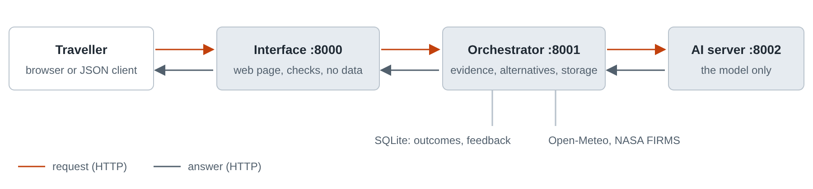
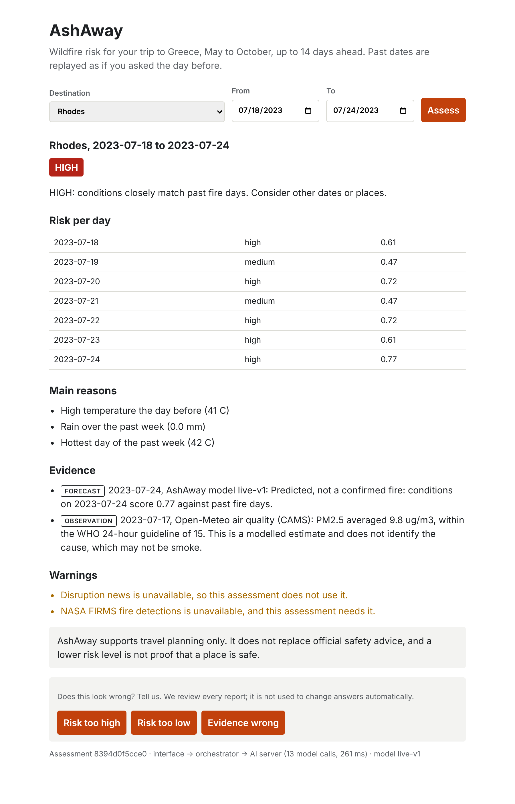

# How to read this report

This report joins our seven assignments into one account of the project, from the problem we set out to solve to the software we finished with. Chapters 1 to 6 are the intermediate reports for Tasks 1 to 6. We revised them only where later work changed the facts: estimates are replaced by measured numbers, plans that we dropped are marked as such, and each chapter opens with a short note on what happened next. Chapter 7 covers Task 7: the final state of the software, our teamwork, and what value sensitive design and environmental impact mean for AshAway.

**Contents**

- How to read this report
- 1. Problem definition, objectives and measurements (Task 1)
- 2. Data, model and software (Task 2)
- 3. Requirements (Task 3, updated to the software as built)
- 4. Project management (Task 4)
- 5. Testing (Task 5)
- 6. Distributed architecture (Task 6)
- 7. Final software, teamwork, values and environment (Task 7)
- References

In short: AshAway runs as three servers. A traveller picks one of 11 Greek destinations and travel dates between May and October, and gets a risk level per day (low, medium or high), the reasons for it, the evidence with its source and date, and lower-risk alternatives. The answer comes from an XGBoost model trained on 25,722 real samples of Mediterranean wildfire data, combined with live weather, satellite fire detections and air quality. When evidence is missing, old or contradictory, AshAway says "insufficient evidence" instead of "low". 164 automated tests check this behaviour on every change.

# 1. Problem definition, objectives and measurements (Task 1)

*What happened next: the scope narrowed to a pilot of 11 Greek destinations. Subproblems 1, 3, 4, 5 and 6 are implemented; subproblem 2 (disruption news) is not yet connected (Chapter 7).*

## 1.1 Problem definition

A traveller booking a summer trip to Southern Europe cannot find out whether wildfires will make the destination dangerous or unpleasant during their dates. The information exists but sits apart: satellite maps show heat and smoke, news reports mention evacuations and closures, air quality services report pollution without naming the cause. Nobody answers the real question: is this place safe between these dates?

**Why it matters.** The 2025 season was the worst on EU record: 1,079,538 hectares burnt across 7,783 fires, nearly double the 2006-2024 average (EFFIS/JRC). Greece evacuated 19,000 people from Rhodes in July 2023, its largest wildfire evacuation, and bookings there fell 76 percent in a week (ForwardKeys). Smoke from the August 2025 Iberian fires reached France and Scandinavia, so a destination can be badly affected with no fire inside it. Projections give up to a tenfold rise in catastrophic fire risk by 2070-2099.

**Subproblems.**

1. Locate the fire: find active fires and burn scars near the destination.
2. Capture the disruption: pick up evacuations, closures and warnings satellites cannot see.
3. Estimate the smoke: work out air quality at the destination and where the plume is heading.
4. Fuse the evidence: turn partial, conflicting sources into one risk level for one place and dates.
5. Justify the answer: say why the place is risky and how old that evidence is.
6. Offer a way out: name comparable destinations with lower risk.

**Proposed solution.** The user gives a destination and a travel window. The system gathers satellite observations, news and social reports, air quality and weather, and past fire records, then fuses them into one judgement. Inputs: destination, dates and these data streams. Outputs: risk level, dated explanation, safer alternatives.

**Scope.** Southern Europe, one country to start (Greece), May to October. AshAway does not route evacuations, support firefighting, or promise that a place is safe.

## 1.2 Objectives

| Level | Objectives |
|----------|------------------------------|
| 1. Organisational (reviewed each season) | Cut the number of travellers who reach a wildfire-affected destination unaware, without harming tourism in places that are safe. |
| 2. Leading (reviewed monthly) | Travellers check before booking, not after landing. Agencies use it in client advice. Users act on warnings and say they trust the explanation. |
| 3. User-oriented (reviewed weekly) | Answer any destination and date window in seconds, flag the places genuinely affected, explain why in plain language, show the evidence age, and offer an alternative. |
| 4. Component (reviewed daily) | Imagery finds fires and burn scars, text extracts evacuations and closures, air quality estimates smoke, fusion produces a calibrated risk level, and explanation states the reasons. |

## 1.3 Measurements

A missed fire hurts a traveller more than a false alarm hurts a hotel, so recall leads.

| Level | Measures |
|----------|------------------------------|
| 1. Organisational | Destinations monitored, and growth per season. Reported cases of travellers caught unaware in a covered area. |
| 2. Leading | Returning users per fire season. Agencies using the tool. Share of users who change plans after a warning. Rated clarity of the explanation. |
| 3. User-oriented | Time to answer a query. Age of the evidence behind the score shown. Share of high-risk answers that carry a usable alternative. |
| 4. Component | Recall (primary), precision guardrail, F-beta with beta above 1. Time to alert, forecast lead time, AUC and Brier calibration, km boundary error, CO2 per update. |

**Headline KPI:** recall on affected destinations, subject to a maximum time to alert. NASA FIRMS publishes detections in roughly three hours, so much of the delay budget is spent before we start.

# 2. Data, model and software (Task 2)

*What happened next: the plan below was carried out on the real data in Task 5. This chapter now gives the measured numbers, following the Task 2 feedback (counts before and after cleaning, split percentages, number of features, file size, how input and output work, alternatives considered and training statistics).*

**System goal.** AshAway predicts fire danger for a 1 km grid cell and day, and turns it into a risk level per destination and day, with a short explanation and lower-risk alternatives. The prediction is kept separate from the user-facing decision.

## 2.1 Data

**Training data.** Mesogeos Track A (Kondylatos et al., Orion Lab NOA, CC BY 4.0), built for next-day wildfire danger forecasting from a 1 km daily Mediterranean datacube. Each sample is a 30-day window for one cell; the last day (row 29) is labelled fire or no fire.

| | Before cleaning | After cleaning |
|-------------|--------------------|--------------------|
| Samples | 25,916 | 25,722 (8,574 fire, 17,148 no fire) |
| Rows | 777,480 | one row per sample, built from days 0-28 |
| File size | 217.8 MB (two CSV files) | |
| Duplicates / incomplete samples | 0 / 0 | |
| Removed | 194 surplus non-fire samples, to keep 2 per fire sample in each split, as the official loader does | |
| Features | 28 usable (weather, vegetation, soil moisture, land-surface temperature, terrain, land cover, roads, population) | 20 used by the product model |

Missing values are highest in night-time land-surface temperature (32.9%), daytime land-surface temperature (28.6%) and soil moisture (12.2%). Outcome columns (burned area, ignition points) are removed, because they describe the fire itself.

**Split, by year and never shuffled**, because neighbouring days share the same weather: train 2006-2019 (19,353 samples, 75.2%), validation 2020 (2,262, 8.8%), test 2021-2022 (4,107, 16.0%).

**A leak we found and fixed.** The first loader used the labelled day as input, which for fire samples is the fire day itself. Results looked too good, we traced the cause, and the loader now uses only days 0-28. Test I1 guards this (Chapter 5).

**Input and output.** The traveller's input is a destination and dates. For each request the system automatically retrieves 29 days of weather from Open-Meteo, satellite fire detections within 20 km from NASA FIRMS, and air quality from Open-Meteo CAMS. It builds the same features as in training, from the days before each trip day only. Fixed features (terrain, land cover, roads, population) come from the destination's Track A cell. The output is a daily risk level, the reasons, labelled and dated evidence, and alternatives.

## 2.2 Model

**Choice.** Gradient-boosted trees (XGBoost): suited to mixed tabular inputs, handles missing values, cheap to train and explainable with feature contributions (SHAP). We considered sequence models (LSTM, transformer) from the Mesogeos benchmark, but they cost far more to train and are harder to explain.

**Alternatives compared on the same data** (test years 2021-2022, all Mediterranean; and Greece in May-October, AshAway's scope):

| Model | PR-AUC | AUROC | Recall | Greece May-Oct PR-AUC |
|-----------------------------------|----------|----------|----------|--------------|
| Hot/dry/windy baseline (no FWI in Track A) | 0.505 | 0.723 | 0.961 | 0.698 |
| Logistic regression | 0.706 | 0.821 | 0.836 | 0.489 |
| Random forest | 0.801 | 0.888 | 0.936 | 0.557 |
| XGBoost, all 28 features | 0.838 | 0.906 | 0.922 | 0.658 |
| **XGBoost, 20 product features (deployed)** | **0.806** | **0.888** | **0.949** | **0.595** |

**Training statistics of the deployed model (`live-v1`).** Training took 0.94 s on a laptop CPU; early stopping chose 570 of up to 600 boosting rounds; inference takes 3.8 ms per 1,000 cell-days. Scores are calibrated on 2020 (isotonic regression). Medium starts at 0.198 (best F2 on 2020, so recall counts double) and high at 0.467 (at least 75% of "high" results were real fires in 2020). After calibration: recall 0.946 and PR-AUC 0.788 on the test years.

**How good is it?** Recall is well above our target of 0.80, and AUROC is close to published Greek results (0.82-0.87) and below 0.92, above which we would suspect leakage. But in Greece in May-October the model does not beat the simple baseline (PR-AUC 0.595 against 0.698, on only 47 fires). We report this as an unmet criterion rather than tune on the test years. The training data has 1 fire per 2 non-fires, far more than in reality, so scores are relative rather than real chances of fire.

## 2.3 Software

What we used: Python; pandas and NumPy for data; scikit-learn for baselines, metrics and calibration; XGBoost for the model; FastAPI, uvicorn and httpx for the three servers; SQLite for storage; pytest and GitHub Actions for testing. Planned in Task 2 but dropped: PyTorch satellite-image segmentation and Hugging Face news classification (no time after the data work; FIRMS detections and the GDELT plan replace them), GeoPandas in the main pipeline (a small built-in Greek boundary is enough), and the late-fusion logistic regression (the evidence rules in Chapter 3 do this job more transparently). CodeCarbon was planned but not run; Chapter 7 estimates the footprint instead.

# 3. Requirements (Task 3, updated to the software as built)

*What happened next: the Task 3 version (v1.1) was revised after feedback in v1.2 (requirements as "the system shall", input, behaviour and output, a success metric each), after the first real-data run in v1.3, and in Task 7 to match the software as built (v1.4, below). The full history is in `docs/requirements/CHANGELOG.md`.*

**Scope.** 11 Greek destinations, each represented by one 1 km grid cell: Ancient Olympia, Chania, Heraklion, Lefkada, Marathon, Nafplio, Naxos, North Evia, Rethymno, Rhodes and Volos. Requests may cover May to October, from June 2006, and up to 14 days ahead. Past dates are assessed as if asked the day before the trip.

## 3.1 User requirements

| ID | Requirement | Success metric |
|-----|----------------------------------------|------------------------|
| UR1 | The system shall allow a user to request a wildfire-risk assessment for a supported Greek destination and chosen travel dates. | ≥ 90% of test users complete a request without help |
| UR2 | The system shall show the risk level in plain language that does not require wildfire knowledge. | ≥ 80% of test users correctly explain the level shown |
| UR3 | The system shall show why a risk level was given and when the supporting information was recorded. | 100% of assessments show reasons and dates |
| UR4 | The system shall make clear whether information is a forecast, an observation or an official warning. | ≥ 90% of test users classify it correctly |
| UR5 | The system shall suggest other destinations with lower estimated risk for the same dates, when such options exist. | Alternatives in 100% of medium/high results where one exists |
| UR6 | The system shall warn the user when information is incomplete or too old for a confident assessment. | 100% of missing/stale test cases show a warning |
| UR7 | The system shall allow a travel adviser to compare destinations for the same dates on the same basis. | ≥ 80% of test advisers compare two destinations within 2 minutes |
| UR8 | The system shall allow a user to report an assessment they believe is wrong, without an account. | 100% of reports stored with the assessment |

## 3.2 Functional requirements

| ID | Input → system behaviour → output | Success metric |
|--------|--------------------------------------------------|--------------------|
| FR1 Must | Destination and dates → the system shall check the destination is supported, dates are valid, start ≤ end, both in May-October of one year, from June 2006, at most 14 days ahead → accepted request or a refusal with the reason | 100% of invalid inputs refused with the right reason |
| FR2 Must [AI] | Accepted request → the system shall compute a calibrated score and a low/medium/high level per day (medium from 0.198, high from 0.467); the trip gets its worst day's level → daily levels with assessment date, generation time and model version | Recall ≥ 0.80 on test years |
| FR3 Must | Each request → the system shall retrieve weather (critical), FIRMS fire detections within 20 km (critical) and air quality (optional), and log each retrieval → evidence items with source and date | 100% of items carry source and date |
| FR4 Must [AI] | Scores and inputs of the peak day → the system shall find the inputs that raised the score most → up to 3 reasons in plain words | 100% use only that place and period |
| FR5 Must | Source status, model level, detections → the system shall detect missing or failed critical sources, data older than 2 days, weather gaps, and a low forecast contradicted by nearby fires → "insufficient evidence" instead of low; medium and high stay visible with a warning | 100% of missing-source cases warned |
| FR6 Should [AI] | Medium or high result → the system shall assess the other destinations for the same dates and keep strictly lower, fully scored ones with the same sources → up to 3 alternatives, "not proof of safety" | 100% lower and comparable |
| FR7 Should | 2 to 11 destinations and dates → the system shall assess all on the same dates and logic → one row each: level, peak score, evidence age, sources | 100% of valid requests |
| FR8 Must | Evidence items → the system shall label each as forecast, observation or official alert → labelled items; a forecast is "predicted, not a confirmed fire" | 100% labelled, 0 mislabelled |
| FR9 Must | Request outside scope → the system shall stop instead of guessing → message naming what is unsupported, no risk level | 100% of out-of-scope requests |
| FR10 Must | Every handled assessment → the system shall store request, outcome, level, model version and answer → an assessment id | 100% stored |
| FR11 Should | Assessment id, verdict, optional comment → the system shall store the report with the assessment and model version for review → confirmation | 100% stored; 0 used for automatic retraining |

## 3.3 Non-functional requirements

| ID | Constraint | Success metric |
|-------------|----------------------------------------|------------------|
| NFR1 Speed | An assessment is shown quickly, or the page shows progress or an error. | ≥ 95% within 5 s in a pilot |
| NFR2 Data quality | Each dataset version records raw and clean counts, removals, missing rates, feature count and size. | 100% of versions |
| NFR3 Input/output | Every feed retrieval is logged; every request carries one id through all three servers' logs. | 100% logged |
| NFR4 Traceability | Every observation has source and time; every prediction is reproducible from the model version. | 100% reproduced |
| NFR5 Resilience | A failed feed or server is marked unavailable; nothing is invented or treated as zero. | 0 invented values |
| NFR6 Usability and safety | Levels in words as well as colours; every result states it does not replace official advice. | 100% of results |
| NFR7 Privacy | No account needed; nothing identifying the traveller is stored. | 0 personal identifiers |
| NFR8 Evaluation [AI] | The training record reports splits, alternatives, features, recall, precision, F2, AUPRC, calibration, training time, rounds and latency. | 100% of model versions |
| NFR9 Validation [AI] | Held-out years; cut-offs tuned on validation to favour recall. | Test years never used for tuning |
| NFR10 Architecture | Three separate servers talking only over HTTP; the interface never calls the AI server or holds data. | Tested on every change |
| NFR11 Maintainability | Unit and integration tests run automatically on every push, without internet. | 100% pass on main |

## 3.4 AI-specific requirements

**AI1 Model choice:** five models compared; the 20-feature XGBoost is deployed because vegetation, soil moisture and land-surface temperature have no live source yet. **AI2 Data:** as in Chapter 2. **AI3 Acceptance:** a version may be used only if, on the test years, recall ≥ 0.80, AUPRC beats the baseline, AUROC is plausible (0.82-0.87 published) and ≤ 0.92; `live-v1` meets all but the baseline criterion for Greece. **AI4 Reporting:** every training run writes a full training record. **AI5 Explainability and uncertainty:** explanations use the inputs actually used; a prediction is never shown as a confirmed fire; scores are calibrated but relative. **AI6 Recommendations:** alternatives only on identical dates and sources, never "proof of safety". **AI7 Updates:** retrain yearly before May; deploy a new version only if it meets AI3; a test checks the deployed version matches its training record. **AI8 Feedback:** users can report a wrong assessment; reports are reviewed by the team, never learned from automatically.

## 3.5 Status

Met and tested: UR1-UR3, UR5, UR6, UR8; FR1, FR2, FR4-FR7, FR9-FR11; NFR2-NFR11; AI1, AI2, AI4, AI6-AI8. Partly met: FR3 (FIRMS adapter tested only on hand-written files, no FIRMS key yet; disruption news not connected), FR8 and UR4 (no official-alert source yet), UR7 (comparison in the API and command line, not on the web page), NFR1 (about 0.3 s measured with recorded data, no pilot yet), AI3 (Greek baseline criterion), AI5 (calibrated on the 1:2 training ratio). The user-test metrics need a pilot with real users, which has not happened. The full traceability table (requirement, code, tests, status) is section 5 of `docs/requirements/SRS.md`.

# 4. Project management (Task 4)

*What happened next: section 7.4 describes how the team worked over the whole project.*

We worked in one-week sprints. Calvin Kakembo was scrum master in Sprint 1 and Hammza Abas in Sprint 2, and the role rotated through the team. We managed the project on Trello ("Ashaway - Software Engineering"), where the lecturer is a member without implementation tasks. We split our requirements into tasks, each with a priority, an owner, a time estimate and implementation notes.

In Sprint 1 we reviewed the requirements, set up the repository and defined the geographic units and prediction targets. In Sprint 2 we built a first XGBoost fire-danger model with a temporal split, a baseline and tests. It still ran on synthetic data, because the loader for the real Mesogeos data had not been tested yet. Based on the feedback on earlier tasks, we also revised the requirements: each one got a success metric, and the functional requirements describe input, behaviour and output. The original version is kept as a backup and all changes are listed in a changelog.

Our code is at github.com/Davidtzuke/AshAway. `main` holds reviewed code only; each feature, documentation change or fix had its own branch and was merged into `main` through a pull request.

Small tasks with one owner made responsibilities clear, and pull requests kept `main` stable. However, we did not hold the planned check-ins every two days, so we noticed late that data preparation was taking longer than expected, and the coding ended up with only a few people. We set out to log check-ins and spread the coding work more evenly in the following sprints.

# 5. Testing (Task 5)

*What happened next: the test suite grew from 118 tests at the end of Task 5 to 164 in Task 7, with tests for the three servers (U9, I7-I10) and for the deployed model version (I11). The tables show the Task 5 test cases.*

**Approach and why these tests.** AshAway's worst failure is false reassurance: a traveller told nothing is wrong when we simply don't know. We chose tests around the ways that could happen: bad requests, wrong units, future data leaking into the model, and failing feeds. Unit tests check one function with hand-computed answers. Integration tests check that components work together on real data. pytest runs them all, and GitHub Actions runs them on every push.

## 5.1 Unit tests: one function, no files or network

| ID | Unit | Test input | Expected output | Why this test |
|----|----------------|-------------------------|-------------------------|---------------------|
| U1 | validate_request | 'atlantis'; end before start; 31 Oct to 1 Nov; end 15 days ahead. Rhodes 2-4 July, today 1 July | Refused: unsupported_place; reversed_dates; out_of_season; beyond_horizon. Accepted with 3 days | Guessing outside our scope gives false advice (FR1, FR9) |
| U2 | risk_level, cut-offs 0.2 and 0.5 | 0.199; 0.2; 0.499; 0.5; 1.01 and NaN | low; medium; medium; high; ValueError | Off-by-one errors live at boundaries (FR2) |
| U3 | is_stale, check_evidence | Value 2 days old; 3 days old; none. Low forecast with 3 fires nearby | Current; stale; stale. Conflict flagged | Old data must never look reassuring (FR5) |
| U4 | parse_weather | 30 °C, 40%, 5 mm. Rain null. {"error": true} | 303.15 K, 0.40, 0.005 m. NaN, not 0. ValueError | Wrong units or an invented 0 corrupt a score (NFR5) |
| U5 | window_features, daily_feature_rows | 8 days with 2 mm rain 2 days ago. Weather including the day itself. Gap in history | rain_7d 0.0025, days_since_rain 2. Uses only the day before. No row | Inputs must match training and not see the future (NFR9) |
| U6 | lower_risk_alternatives | High risk; candidates high, medium, low, and low with poor coverage | Low, then medium; others excluded | An equal-risk "alternative" would mislead (FR6) |
| U7 | choose_threshold_f2, fit_calibration, high_threshold | Toy labels and scores with a known answer | Threshold 0.4; monotonic calibration; lowest score reaching the precision target | Cut-offs decide what travellers see (NFR9) |
| U8 | in_greece | Athens, Rhodes, Corfu. Izmir, Tirana, open sea | True. False | Greek results must not include neighbours (AI4) |

## 5.2 Integration tests: several components together

| ID | Components | Test input | Expected output | Why this test |
|----|---------------|----------------------|-----------------------------|---------------------|
| I1 | Loader, split, data report | 114 real Track A samples | Inputs stop the day before the label; no outcome columns; 36 per split at 2:1; 114 raw, 6 removed, 108 clean | Guards the fire-day leak we found (AI2, NFR9) |
| I2 | Training, calibration, save, load | Same sample | Reloaded model gives identical predictions; record lists 5 models and all NFR8 metrics | Each prediction must be reproducible (NFR4) |
| I3 | Feeds, features, model, service | Rhodes 18-24 July 2023, recorded feeds. Chania 1-3 June 2023 without, then with, a fire nearby | High, 7 days, every item labelled, dated and sourced, nothing after 17 July. Low. Insufficient evidence with a conflict warning | A known real event checks the whole answer (FR2-FR4, FR8) |
| I4 | Feeds and service under failure | Weather HTTP 500. Fire feed down with a low, then a high forecast. Air quality down | No score or reasons. Insufficient evidence; high stays with a warning. No air item | Failure must never read as "safe" (FR5, NFR5) |
| I5 | Service across destinations | Rhodes 1-3 July 2023. Rhodes and Chania on the same dates | 1-3 alternatives, strictly lower and sorted. One comparable row per place | Advice must compare like with like (FR6, FR7) |
| I6 | Command line, service, feeds | assess rhodes 2023-07-18 2023-07-24; atlantis; December dates | Exit 0 with risk in words, reasons, labels, disclaimer. Exit 2 with the reason, no level | This is what a traveller sees (UR1-UR4) |

**Test data.** Hand-computed values for unit tests. A real Mesogeos Track A sample of 114 samples (3,420 rows) with real gaps and fire days, small enough for automated runs. Recorded Open-Meteo responses from 2023, including the July Rhodes heatwave. Simulated HTTP 500 errors, since real services don't fail on demand. Hand-written FIRMS files in NASA's documented format, which are not real detections, because our API key is not set up yet.

**Results.** All 118 Task 5 tests passed, locally and on GitHub Actions, in about 5 seconds, with 93% line coverage. To check that the tests can fail, we broke the code on purpose in 8 ways, such as feeding the fire day to the model or treating missing rain as zero, and all 8 were caught. Passing tests mean the software behaves as specified, not that the forecast is accurate: model quality is measured separately (Chapter 2).

# 6. Distributed architecture (Task 6)

*What happened next: following the Task 6 feedback, the storage moved from the interface to behind the orchestrator in Task 7. This chapter describes the revised design.*

{width=16cm}

AshAway runs as three logical servers, each its own process and port, that talk only over HTTP. They run on one machine; each can move to another machine by changing one URL.

| Server | Port | Does | Never does |
|-------------|------|---------------------------------------------|--------------------------|
| Interface | 8000 | Web page and JSON API. Checks every request (place, dates, season, horizon) before anything else runs. Forwards valid ones, and requests for stored assessments and feedback, to the orchestrator. Keeps no data. | Call the AI server or touch the database. It has no address for the AI server and loads no model or storage code (tested). |
| Orchestrator | 8001 | Runs the assessment logic: feeds, features, evidence checks, alternatives, comparisons. Sends every prediction to the AI server through RemoteModel, which has the same methods as the local model. Stores every assessment, its outcome and feedback in SQLite. | Load the model. |
| AI server | 8002 | The only process that loads the model. /model gives version, features and cut-offs; /predict gives calibrated probabilities and feature contributions. | Know about places, dates or feeds. |

**Why HTTP and not a message queue.** A traveller waits for every answer, an assessment takes well under a second, and there are three services. A broker such as RabbitMQ would add a fourth process without changing what the traveller sees. If background jobs are ever needed, a queue goes into the orchestrator only.

**Why the data sits behind the orchestrator.** In the Task 6 version the interface kept its own SQLite file. The lecturer asked why, and we agreed: the interface should only take requests and pass them on. Now the interface is stateless, so it can be restarted or replaced without losing anything, and all data sits behind one server, next to the work that produces it.

**Tracing and failures.** Each request gets an id that every server logs and returns, so one request can be followed through all three logs. A bad request stops at the interface (400). An orchestrator or AI outage reaches the traveller as a 503 with no risk level. A failed feed is marked unavailable, and "insufficient evidence" replaces a low result. Every outcome the orchestrator sees is stored.

**How to run it.** `python -m ashaway.services` starts all three processes; `--replay` uses recorded 2023 weather so a demonstration works without internet. Then open http://127.0.0.1:8000.

**Verification.** U9 tests RemoteModel against an in-memory fake AI server; I7 the AI server's API; I8 the orchestrator with the AI server and storage; I9 the interface, including that it loads no model or storage code; I10 all three servers on real sockets, with one request id end to end and the same answer as the single-process version.

# 7. Final software, teamwork, values and environment (Task 7)

## 7.1 Final code

We finished the tasks on our ToDo list (`docs/TODO.md`), where every commit message starts with its task id. In Task 7 we moved the storage behind the orchestrator (T24, from the Task 6 feedback); gave every public function and class a docstring and kept the lint check clean (T25); rewrote the README as the entry point to the project; checked the deployed model (T26); and updated the requirements (T27). All 164 tests pass (87 unit, 77 integration), locally and on GitHub Actions, and everything is merged into `main` through pull requests.

## 7.2 Operation

We started the three servers as separate processes and used the system as a traveller would. Rhodes, 18-24 July 2023 (the week of the evacuation) comes back **high**, with 13 calls to the AI server in about 0.2 seconds; the answer is stored and can be retrieved, and feedback on it is stored beside it. "Atlantis" is refused at the interface with the reason, and the other servers are not contacted. In the three-server tests, a stopped AI server or orchestrator gives the traveller a clear "unavailable" message and no risk level.

{width=9cm}

Two limits remain in live use. Without a FIRMS key, fire detections are unavailable, so AshAway never states a low result (it says "insufficient evidence"), which is safe but less useful. And disruption news and official alerts are not connected yet.

## 7.3 Requirements and AI model

The SRS (version 1.4, Chapter 3) now describes the software as built, with a traceability table and an honest status per requirement. The deployed model `live-v1` is the latest trained version: its version, cut-offs, 20 features and 570 boosting rounds match the training record, and test I11 checks this on every change. The AI server serves it through `/model` and `/predict`, and test I7 checks that its answers equal the model's own. A new version is deployed only after it passes the acceptance criteria (AI7).

## 7.4 Teamwork

**Roles.** The work was split into Trello tasks with one owner each. Main responsibilities: Calvin Kakembo, project overview and scrum master in Sprint 1; Hammza Abas, data preparation and validation, scrum master in Sprint 2; Amin El Amrani, unit tests and the risk thresholds; Rayan Fikri, integration tests and model evaluation; Mikail Kaya, the assessment service, the test suite and continuous integration; David Vasilescu, the repository, safety and limitations.

**Working as a team.** One-week sprints with a rotating scrum master; a Trello board with an owner, priority and estimate per task; one branch per task, merged into `main` only through pull requests, with task ids in every commit; and a shared plan in which every member presented part of the testing demonstration.

**Challenges.** The real data had no direct download link, so the first model ran on synthetic data until we wrote a download script. The first real results looked too good; we traced this to the loader using the fire day as input, fixed it and added a test. Missing FIRMS access and unreliable internet in demos were solved with recorded data and a replay mode. Our weakest point was workload balance, as the lecturer also noted: check-ins were missed in the first sprints and most code was written by a few members. Smaller tasks and a demonstration part for everyone helped, but the balance stayed uneven.

## 7.5 Value sensitive design and environmental impact

**Value sensitive design.** AshAway touches *safety* (no false reassurance), *honesty* (labelled, dated evidence), *privacy* (no account, nothing about the traveller stored), *autonomy* (it advises, the traveller decides), *accountability* (model version and feedback on every answer) and *fairness to destinations*: a "high" label can cost a community its bookings, as Rhodes lost 76% in a week. We designed for the first five because they followed from our requirements, not from a value analysis. With VSD from the start we would have begun with stakeholders rather than data: travellers, advisers, local residents and businesses, and civil protection. We would also have tested with real users, checked that errors are fair across regions (the model is weaker for Greece), and corrected scores to the real fire rate so "high" does not alarm more than the evidence supports.

**Environmental impact.** *AI component:* small, by choice. Training all five candidate models took about 6 seconds on a laptop CPU (under 1 s for the deployed one), roughly 0.1 Wh; 1,000 predictions take 3.8 ms. Choosing XGBoost over the GPU-trained sequence models of the Mesogeos benchmark is the main reason; the data was downloaded once (218 MB) and retraining is planned yearly. *Non-AI part:* likely larger over time. Three servers run continuously; each assessment with alternatives makes up to 23 calls to external services and 13 to the AI server, recomputing what another traveller may have asked minutes earlier; and every one of the 20+ GitHub test runs started a cloud machine for about a minute. Caching weather per destination and day, running servers only when needed, and measuring with CodeCarbon (planned in Task 2) would reduce and document this.

## 7.6 Conclusion

AshAway answers the question from Task 1 for 11 Greek destinations: how risky is this place between these dates, why, how recent is the evidence, and where else could I go. It does so honestly, saying "insufficient evidence" rather than "low" when it does not know, and its behaviour is checked by 164 automated tests. The main gaps are a model that is not yet better than a simple rule for Greece, missing fire detections without a FIRMS key, no disruption news or official alerts, and no test with real users. Those are the next steps.

# References

- Kondylatos, S. et al. (2022). Wildfire danger prediction and understanding with deep learning. *Geophysical Research Letters*.
- Kondylatos, S., Prapas, I. et al. (2023). Mesogeos: a multi-purpose dataset for data-driven wildfire modeling in the Mediterranean. *NeurIPS Datasets and Benchmarks*. Data under CC BY 4.0.
- European Forest Fire Information System (EFFIS), Joint Research Centre, annual fire reports.
- NASA FIRMS, VIIRS active fire detections. Open-Meteo weather, archive and CAMS air-quality APIs (CC BY 4.0).
- ForwardKeys, travel booking data on Rhodes, July 2023.
